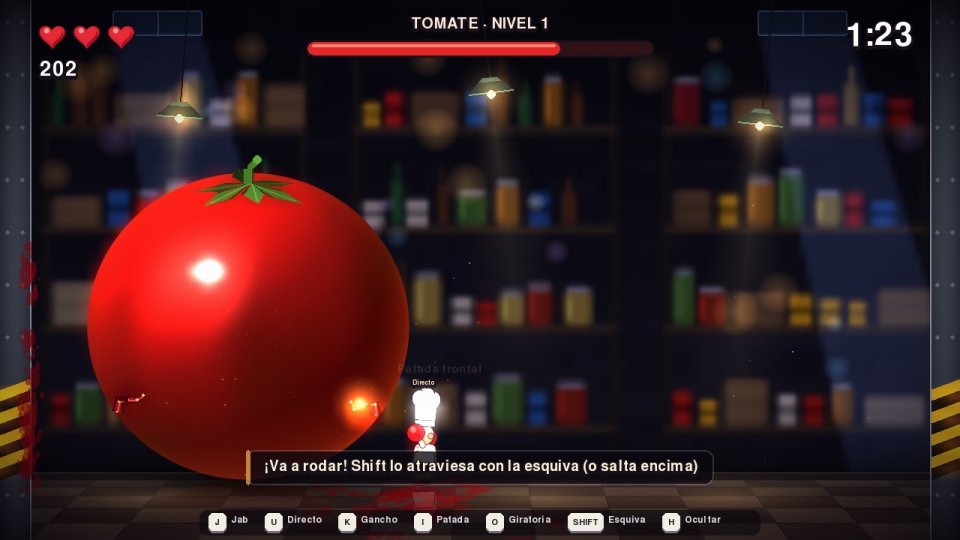
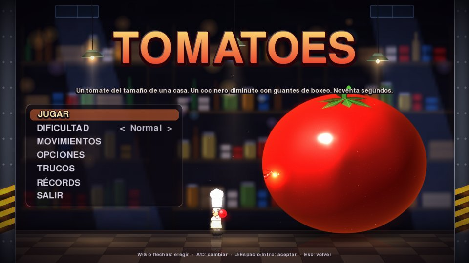
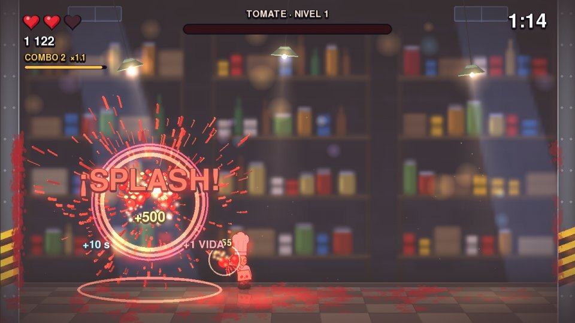
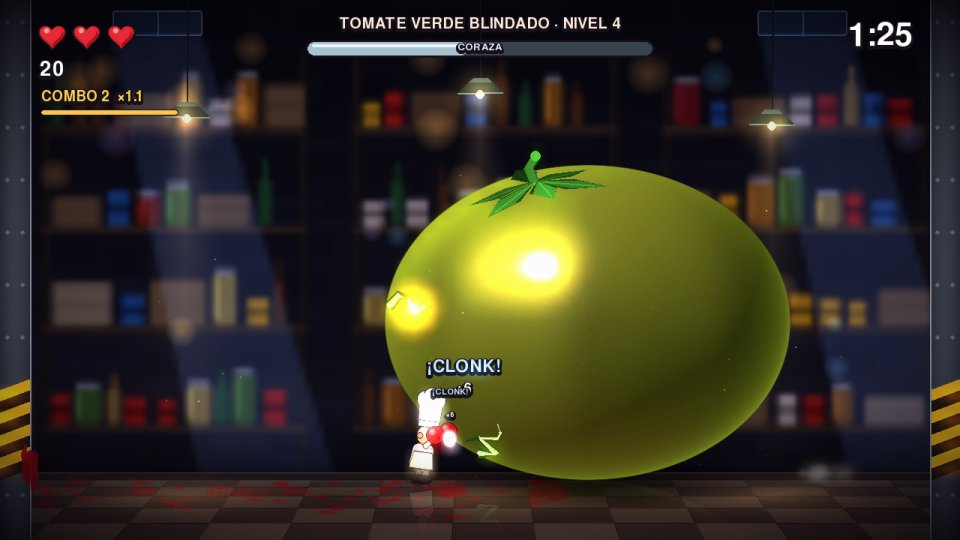
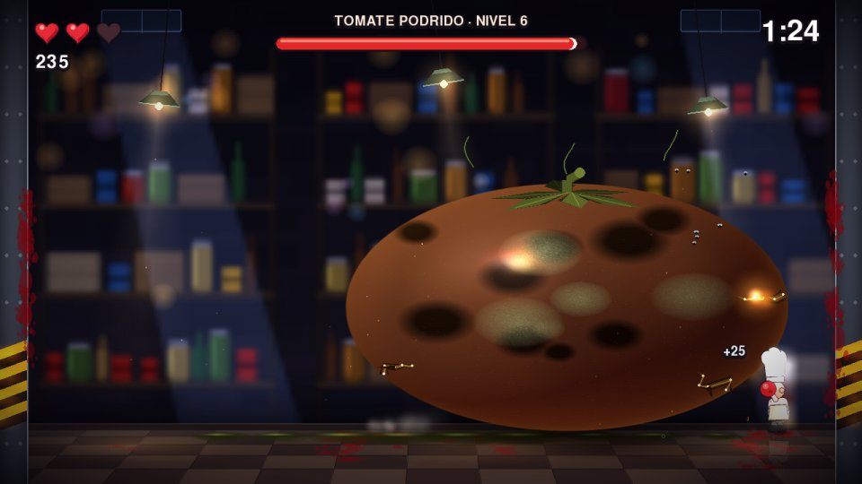
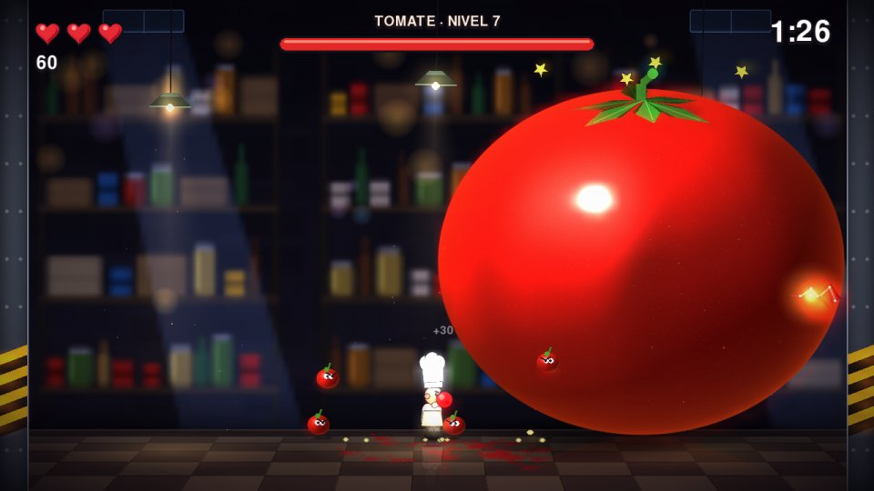
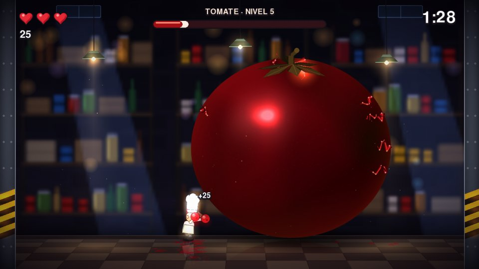
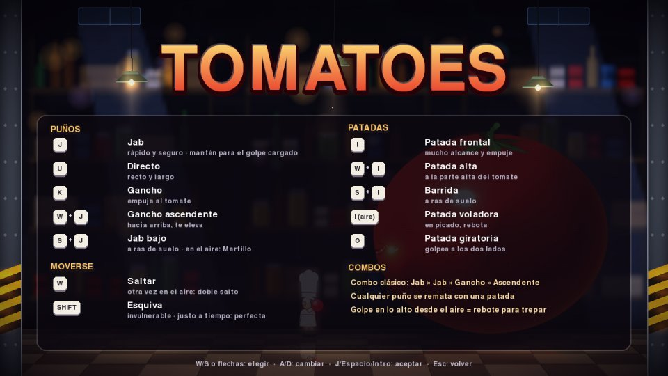

# 🍅 TOMATOES

> Un tomate del tamaño de una casa. Un cocinero diminuto con guantes de boxeo. Noventa segundos.

**TOMATOES** es un arcade de acción en 2D con vista lateral, escrito en Python. Controlas a **Rufo**, un pinche de cocina bajito y testarudo que ha decidido que el tomate gigante que ha aparecido en su almacén no va a acabar en salsa por las buenas. Corres, saltas, esquivas y golpeas hasta que el tomate revienta. Luego aparece otro, más grande y con peor carácter.

Todo el juego cabe en **un único fichero, `pytomatoes.py`**. No usa ni una imagen ni un sonido externos: los gráficos, las luces, las partículas, los efectos de sonido y la música se generan por código al arrancar.



| | |
|---|---|
|  |  |
|  |  |
|  |  |

*Capturas generadas por el propio juego con `python pytomatoes.py --shots DIR`.*

---

## Cómo jugar

Necesitas Python 3.12 o posterior.

```bash
pip install pygame-ce numpy
python pytomatoes.py
```

O, con [uv](https://docs.astral.sh/uv/), sin instalar nada a mano (el fichero declara sus dependencias):

```bash
uv run pytomatoes.py
```

> ⚠️ No instales `pygame` y `pygame-ce` a la vez: los dos ocupan el módulo `pygame` y se pisan.

| Opción | Qué hace |
|---|---|
| `--mute` | Arranca sin sonido |
| `--selftest` | Comprueba las mecánicas una a una y juega una partida completa con un bot, sin ventana |
| `--shots DIR` | Guarda en `DIR` capturas PNG de cada pantalla y de cada tipo de tomate |

---

## Controles

| Acción | Teclado | Mando |
|---|---|---|
| Moverse | `A` / `D` o `←` / `→` | Stick izquierdo / cruceta |
| Saltar (doble salto en el aire) | `W`, `↑` o `Espacio` | A / ✕ |
| Agacharse | `S` o `↓` | Abajo |
| **Puños** | | |
| Jab (mantener: golpe cargado) | `J` | X / □ |
| Directo | `U` | LB / L1 |
| Gancho | `K` | Y / △ |
| Gancho ascendente | `↑` + `J` | Arriba + X / □ |
| Jab bajo (agachado) | `↓` + `J` | Abajo + X / □ |
| Martillo aéreo | `↓` + `J` en el aire | Abajo + X / □ en el aire |
| **Patadas** | | |
| Patada frontal | `I` | B / ○ |
| Patada alta | `↑` + `I` | Arriba + B / ○ |
| Barrida | `↓` + `I` | Abajo + B / ○ |
| Patada voladora | `I` en el aire | B / ○ en el aire |
| Patada giratoria (a los dos lados) | `O` | Back / Select |
| **Defensa** | | |
| Esquiva rápida | `Shift` o `L` | RB / R1 |
| Pausa | `P` o `Esc` | Start |
| Pantalla completa | `F11` | — |
| Bloom on/off | `B` | — |
| Silenciar | `M` | — |
| Mostrar u ocultar las teclas en pantalla | `H` | — |
| Depuración (cajas de colisión y estados) | `F3` | — |

**El juego te enseña las teclas** de tres maneras: la pantalla **MOVIMIENTOS** del menú principal, la lista completa en la **pausa**, y una **barra de teclas** al pie de la pantalla durante la partida (`H` la oculta; también en Opciones). Además, cada golpe especial muestra su nombre sobre Rufo al hacerlo. Si reasignas teclas, todas estas guías enseñan las tuyas.



En los menús: `W`/`S` o flechas para elegir, `A`/`D` para cambiar un valor, `J`/`Espacio`/`Intro` para aceptar y `Esc` para volver. El mando navega con la cruceta o el stick. En pausa, `Q` vuelve al menú. El juego se pausa solo si la ventana pierde el foco o se desconecta el mando.

**Las teclas se pueden reasignar** en `~/.tomatoes/config.json`, con los nombres de tecla de pygame (`"a"`, `"left"`, `"left shift"`, `"f11"`…). El juego crea ese fichero la primera vez, junto con las opciones del menú.

---

## Menú, opciones y récords

- **Dificultad:** *Fácil* (avisos un 30 % más largos, más pausa entre ataques, golpes de Rufo un 25 % más fuertes; puntos ×0,75), *Normal* y *Difícil* (avisos más cortos, tomates más rápidos; puntos ×1,5).
- **Movimientos:** todos los puños y patadas con sus teclas (las que tengas configuradas) y los combos.
- **Opciones:** volumen de música y de efectos por separado, intensidad de la sacudida de cámara (0–100 %), destellos normales o reducidos (sin aberración cromática y con flashes suaves), bloom, vibración del mando, pantalla completa, tutorial y teclas en pantalla. Todo se guarda al momento.
- **Trucos:** un menú propio con interruptores que se guardan entre partidas:

  | Truco | Efecto |
  |---|---|
  | Vidas infinitas | Los golpes no quitan corazones |
  | Reloj congelado | El tiempo no corre |
  | Golpe de titán | Rufo hace el triple de daño |
  | Punto débil gigante | El punto débil se ve y se acierta mucho más fácil |
  | Esquiva sin espera | La esquiva se recarga casi al instante |
  | Empezar en el nivel | Del 1 al 16, para practicar contra el verde, el podrido o las cherrys |
  | Velocidad del juego | 50 %, 75 %, 100 %, 125 % o 150 % |
  | Rufo cabezón | Cabeza y gorro enormes (solo estético) |
  | Tomates arcoíris | El tomate cambia de color sin parar (solo estético) |

  Con cualquier truco que no sea estético activo, la partida lleva la marca «TRUCOS» y **la puntuación no entra en la tabla de récords**. La demo siempre juega sin trucos. «Desactivar todos» los apaga de golpe.
- **Tabla de récords:** los 10 mejores, con iniciales, nivel alcanzado y dificultad. Al terminar una partida que entra en la tabla, escribes tus tres iniciales.
- **Modo demo:** si nadie toca nada en el título durante 20 segundos, Rufo juega solo. Cualquier tecla vuelve al menú.
- **Tutorial:** la primera vez, el nivel 1 enseña lo esencial con consejos que aparecen según lo que pasa en pantalla: cómo golpear, cómo esquivar la rodada o el bote, cuándo castigar al tomate aturdido, dónde está el punto débil y cómo trepar. Desaparece al superar el nivel 1 (se puede reactivar en opciones).

---

## Reglas

- La ronda dura **90 segundos** y Rufo tiene **3 corazones**.
- La partida acaba si el reloj llega a cero **o** si Rufo pierde todos los corazones.
- Cada tomate reventado suma **10 segundos**, recupera **1 corazón** (máximo 3), da `500 × nivel` puntos y hace aparecer el siguiente nivel.

```
Aparece tomate ──► Rufo se acerca, esquiva y golpea ──► El tomate se agrieta y contraataca
       ▲                                                          │
       │                                                          ▼
  Siguiente nivel ◄── +10 s, bonus y 1 corazón ◄── ¡SPLASH! (revienta)
```

### El ritmo: esquivar, castigar, repetir

El tomate **siempre avisa** antes de atacar: con una animación, un sonido y, a veces, una marca en el suelo. Después de cada ataque queda **aturdido 0,8 s**, con estrellas girando sobre él. Los golpes en esa ventana valen el doble de puntos y suman el doble de combo.

| Ataque | Aviso | Cómo esquivarlo | Desde |
|---|---|---|---|
| **Rodar** | Se encoge y tiembla (0,6 s) | Esquiva a través de él, o salta encima y cabalga la rodada | Nivel 1 |
| **Bote aplastante** | Salta fuera de pantalla; su sombra crece en el suelo (0,8 s) | Salir de la sombra, o esquivar justo al impacto | Nivel 1 |
| **Chorro de jugo** | Se hincha por un lado; línea de aviso y «¡AGÁCHATE!» / «¡SALTA!» (0,5 s) | Agacharse (chorro alto) o saltar (chorro bajo) | Nivel 3 |
| **Lluvia de pepitas** | Tiembla con chasquidos (0,7 s); el suelo marca dónde caerán | Colocarse en uno de los huecos | Nivel 5 |
| **Enjambre de cherrys** | Se estira y suenan tres «pops» (0,6 s) | Escupe cherrys con ojos que saltan hacia Rufo y hacen daño al tocarlo. Revientan de un golpe: el jab bajo es ideal | Nivel 7 |
| **Furia** (con menos del 25 % de vida) | Se pone rojo oscuro y vibra | Encadena dos ataques seguidos antes de aturdirse | — |

Si Rufo está de pie sobre el tomate cuando va a rodar o botar, el tomate se lo sacude de encima sin hacerle daño.

### Tomates especiales

| Tomate | Niveles | Qué cambia |
|---|---|---|
| **Verde blindado** | 4, 8, 12… | Tiene una **coraza**: los jabs rebotan («¡CLONK!») y los golpes fuertes solo hacen la mitad de daño hasta romperla. Ganchos, cargados, martillos y críticos la rompen. Al romperse, el tomate **madura** a rojo ante tus ojos |
| **Podrido** | 6, 10, 14… | Pardo, con manchas, moho y moscas. Al rodar, botar o recibir golpes fuertes deja **charcos que resbalan**: en ellos Rufo tarda nueve veces más en frenar |
| **Normal** | El resto | Rojo y jugoso |

### El punto débil

Cada tomate tiene un **punto débil** que brilla con pulso en una grieta. Golpearlo es un **crítico**: daño ×2, «¡JUGOSO!», zoom y aberración cromática. Después de cada crítico, el punto débil salta a otra grieta. Nunca aparece por debajo del tomate, donde no llega nadie, pero puede quedar arriba: entonces hay que **trepar**.

### Trepar

Con doble salto, Rufo llega a la corona del tomate del nivel 1. Para los tomates más grandes: cualquier golpe aéreo en la mitad alta del tomate hace **rebotar** a Rufo y le devuelve el doble salto. Así se encadenan golpes sin tocar el suelo y se sube a lo más alto.

### Escalado por nivel

| Propiedad | Nivel 1 | Por nivel | Tope |
|---|---|---|---|
| Radio | 220 px | +12 px | 320 px |
| Vida | 30 | +10 | — |
| Pausa entre ataques | 3,0 s | −0,25 s | 1,2 s |
| Coraza (tomate verde) | — | 10 + 2 × nivel | — |

---

## Golpes

Los tiempos están en fotogramas a 60 FPS: preparación, golpe activo y recuperación.

| Golpe | Entrada | Tiempos | Daño | Puntos | Notas |
|---|---|---|---|---|---|
| **Jab** | `J` | 3 / 3 / 8 | 1 | 10 | Rápido y seguro; abre combos |
| **Jab bajo** | `↓` + `J` | 3 / 3 / 8 | 1 | 10 | Barre a ras de suelo y mantiene a Rufo agachado (esquiva el chorro alto mientras golpea) |
| **Directo** | `U` | 5 / 4 / 13 | 2 | 20 | Recto y largo, con el puño de atrás |
| **Gancho** | `K` | 7 / 4 / 14 | 2 | 25 | Más alcance; empuja al tomate |
| **Gancho ascendente** | `↑` + `J` | 6 / 5 / 16 | 2 | 25 | Golpea hacia arriba y eleva a Rufo una vez por salto |
| **Golpe cargado** | Mantener `J` 0,4–1,2 s y soltar | — / 6 / 20 | 3–6 | 15 × daño | Rufo brilla dorado y es vulnerable mientras carga |
| **Martillo aéreo** | `↓` + `J` en el aire | 5 / 8 / 18 | 3 | 40 | Picado sobre la corona del tomate |

### Patadas

Más lentas que los puños, pero con más alcance y mucho más empuje. Todas cuentan como golpe fuerte contra la coraza del tomate verde.

| Patada | Entrada | Tiempos | Daño | Puntos | Notas |
|---|---|---|---|---|---|
| **Frontal** | `I` | 6 / 5 / 16 | 2 | 25 | La de más alcance; aparta al tomate |
| **Alta** | `↑` + `I` | 7 / 5 / 18 | 3 | 35 | A la parte alta, donde suele estar el punto débil |
| **Barrida** | `↓` + `I` | 5 / 6 / 16 | 2 | 25 | A ras de suelo y agachado: barre cherrys y esquiva el chorro alto |
| **Voladora** | `I` en el aire | 4 / 10 / 16 | 3 | 40 | Picado en diagonal; rebota si da en lo alto |
| **Giratoria** | `O` | 8 / 8 / 20 | 3 | 40 | Media vuelta: golpea delante **y detrás** |

- **Cadena:** durante la recuperación de un golpe se puede lanzar el siguiente si la secuencia es válida: Jab → Jab → Gancho → Gancho ascendente. En el cuarto paso basta con `J`.
- **Cancelaciones libres:** el Jab se puede cancelar en Directo o en cualquier patada; el Directo en Gancho o patada; el Gancho en patada; el Ascendente en Patada voladora, y la Frontal y la Barrida en Giratoria. Por ejemplo: Jab → Directo → Gancho → Patada giratoria.
- **Búfer de entrada de 0,1 s:** si pulsas un poco antes de que termine la recuperación, el golpe sale igual.
- **Pared:** si empujas al tomate contra una pared con un gancho o un golpe cargado, rebota y queda aturdido.

## Puntuación y combo

| Acción | Puntos |
|---|---|
| Crítico (punto débil) | ×2 |
| Golpe durante el aturdimiento | ×2, y el combo sube de dos en dos |
| Golpe absorbido por la coraza | ¼ de lo normal |
| Reventar una cherry | 30 |
| Esquiva perfecta (esquivar en los últimos 0,15 s antes del impacto) | 100 |
| Reventar un tomate | 500 × nivel |

- **Combo:** cada golpe encadenado en menos de 1,2 s lo incrementa. El multiplicador es `1 + 0,1 × (combo − 1)`, con tope en **×5**. Los combos de 10, 20, 30 y 41 golpes se celebran en pantalla.
- **El combo se rompe** si Rufo recibe daño o si pasa la ventana sin golpear.

---

## Dirección visual

- **Almacén de cocina de noche:** estanterías desenfocadas (profundidad de campo), luces lejanas en *bokeh*, claraboyas con luz de luna, polvo en suspensión que brilla al cruzar los conos de luz, y lámparas colgantes que oscilan cuando el tomate bota.
- **El tomate:** sombreado píxel a píxel con numpy. Tiene luz principal, gajos, translucidez en el borde (la luz atraviesa la piel), rebote cálido del suelo, brillo especular difuso y punto de luz duro. A medida que pierde vida se oscurece y se llena de moratones; cada golpe abre una grieta en cuña con interior jugoso y pepitas, y gotea cuando está malherido. El cáliz de seis hojas se marchita. El verde pasa por naranja al madurar; el podrido es mate, con manchas y moho.
- **Rufo:** figura vectorial supermuestreada ×2, con contorno fino y **animación procedural**: inclinación al correr, polvo en las pisadas, estirarse al saltar, aplastarse al aterrizar, golpes como poses clave con curvas elásticas, gorro con su propio muelle y cejas testarudas. Brilla dorado al cargar, destella en blanco al recibir daño, parpadea cuando es invulnerable y el delantal guarda las manchas de jugo toda la partida.
- **Efectos:** suelo pulido con reflejos, manchas persistentes en suelo y paredes que se desvanecen poco a poco, estelas de guante, fantasmas de la esquiva, ondas de choque, bloom, viñeta y aberración cromática en los críticos.
- **Sensación de golpe (*game feel*):** pausa breve en cada impacto (*hit-stop*), sacudida de cámara proporcional al golpe, zoom sobre Rufo en los críticos, cámara lenta al reventar, vibración del mando y marcador que cuenta hacia arriba.

## Audio

Todo se sintetiza con numpy al arrancar: golpes de distinta intensidad, chapoteo en los críticos, el «clonk» metálico de la coraza, un aviso propio para cada ataque (crujido grave al rodar, silbido ascendente al botar, gorgoteo antes del chorro, chasquidos antes de las pepitas, «pops» antes de las cherrys), «tic» en los últimos 10 segundos, el estampido del ¡SPLASH! y un bucle musical con bombo, caja, bajo y acordes. Si no hay dispositivo de audio, el juego arranca igual, mudo.

---

## Técnica

| Pieza | Elección |
|---|---|
| Lenguaje | Python 3.12+ |
| Ventana, entrada, mando y audio | **pygame-ce** ≥ 2.4 |
| Sombreado procedural y síntesis de audio | **numpy** |
| Configuración, opciones y récords | JSON en `~/.tomatoes/` |

Decisiones clave:

- **Física a paso fijo de 120 Hz**, separada del render, para que saltos y tiempos de golpe sean iguales en cualquier máquina.
- **Interpolación de render:** el dibujo interpola entre los dos últimos pasos de física, así que el movimiento es suave a 60, 144 o 240 Hz sin tocar la simulación.
- **Búfer de entrada de 0,1 s** y ***coyote time*** de 0,1 s: la diferencia entre un control rígido y uno que se siente bien.
- **Combate con cajas de golpe** rectangulares contra la elipse del tomate, sin colisión por píxel: predecible y fácil de ajustar.
- **Rufo y el tomate son máquinas de estados explícitas**, visibles con `F3`.
- **Horneado en segundo plano:** sombrear un tomate cuesta entre 130 y 330 ms. Un hilo aparte lo hace con numpy mientras se juega, incluido el tomate del nivel siguiente, y el combate nunca espera: si un tramo de daño aún no está listo, se usa el más parecido durante unos fotogramas.
- **Modo sin pantalla** (`SDL_VIDEODRIVER=dummy`) para el selftest y las capturas. Ambos usan un directorio temporal y nunca tocan tus opciones ni tu récord.

### Organización del fichero

`pytomatoes.py` está dividido en secciones numeradas:

1. Constantes (física, tiempos de golpe, variedades, dificultad, opciones, controles por defecto)
2. Utilidades (muelles, curvas de suavizado, sprites procedurales cacheados)
3. Audio sintetizado
4. Entrada: teclado, mando y reasignación
5. Rufo: física, estados y golpes
6. El tomate: cerebro, ataques, coraza y daño
7. Efectos: partículas, manchas, ondas y textos
8. Escenario: el almacén
9. Render del tomate (con horneado en segundo plano)
10. Render de Rufo
11. Texto e interfaz
12. El juego: estados, menús, trucos, combate, cherrys, charcos, dibujo y postprocesado
13. Arranque, selftest, galería de capturas y bot

### Pruebas e integración continua

`python pytomatoes.py --selftest` comprueba, con entradas simuladas:

- el golpe cargado, la cadena de golpes, que cada puño y patada sale con su tecla y conecta, que la giratoria pega hacia atrás, las cancelaciones y que se puede trepar al tomate;
- que la esquiva atraviesa la rodada y que el chorro bajo se salta;
- la coraza del tomate verde, los charcos del podrido y las cherrys;
- el menú, que las opciones, los trucos y los récords se guardan, que con trucos no se entra en la tabla, y el modo demo;
- unos segundos de cada tomate especial jugados por un bot, y una partida completa.

GitHub Actions lo ejecuta en cada *push* con Python 3.12 y 3.13, pasa el linter y publica las capturas como artefacto.

### Rendimiento

Medido con el selftest sin pantalla, en CPU y sin GPU: un fotograma completo con bloom tarda **unos 8 ms de media y unos 12 ms en el 5 % más lento**. El peor fotograma de una partida completa, cambio de nivel incluido, se queda en 25–35 ms. Holgado para 60 FPS y cerca de 120.

---

## Ideas para después

- Postprocesado por GPU con moderngl (bloom real, distorsión).
- Guantes alternativos con otras propiedades.
- Modo cooperativo con un segundo pinche.
- Reasignación de teclas desde el propio menú.

## Licencia

[MIT](LICENSE).
